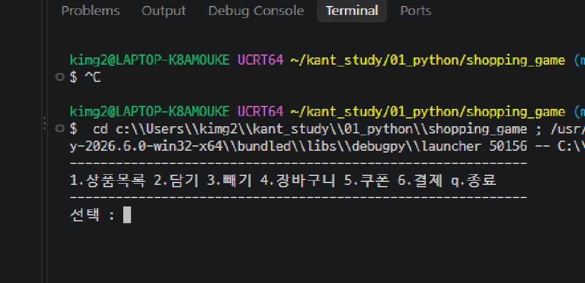
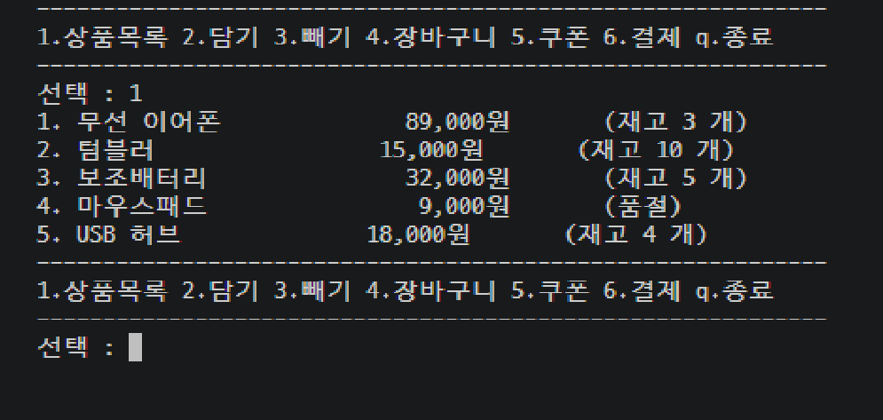
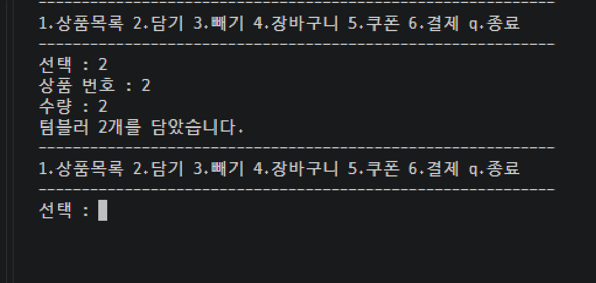
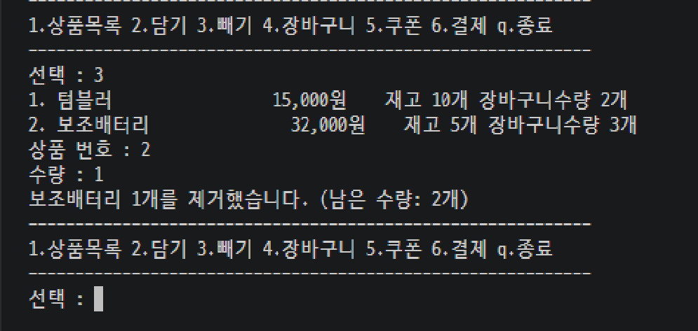
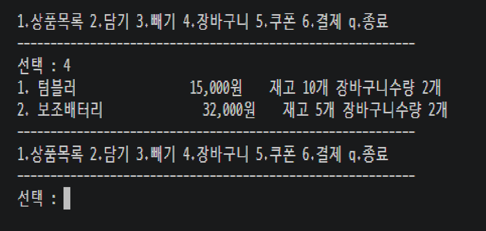
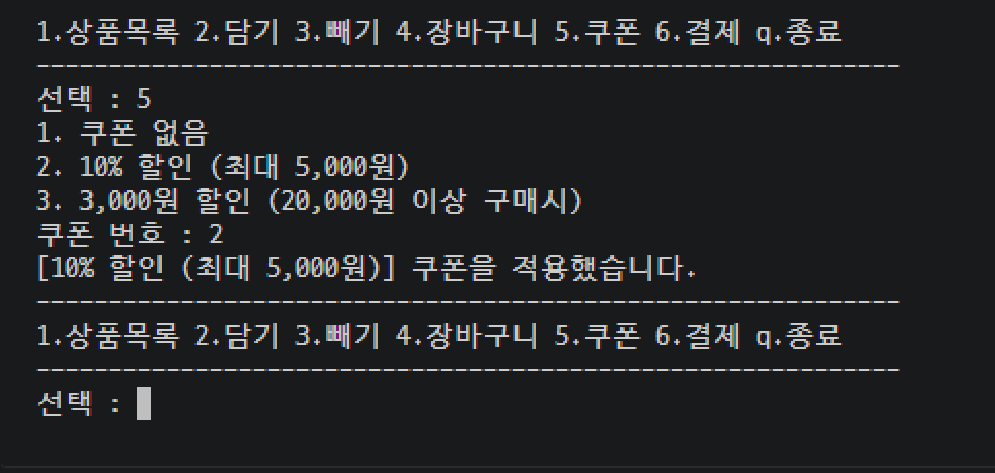
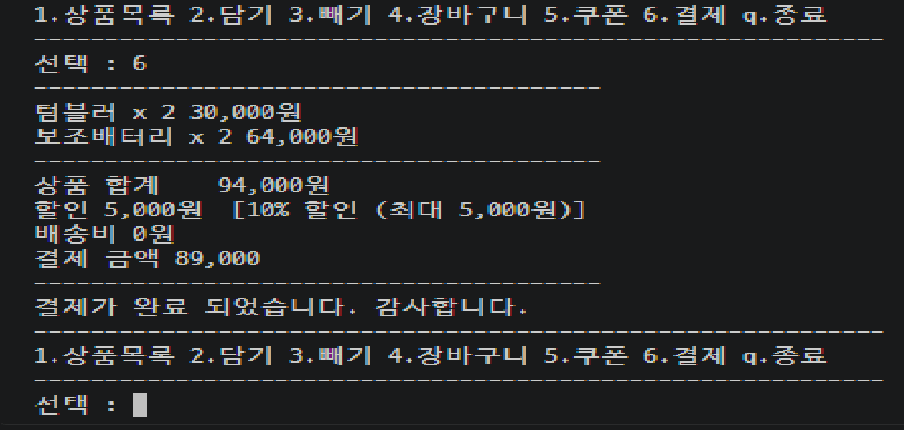
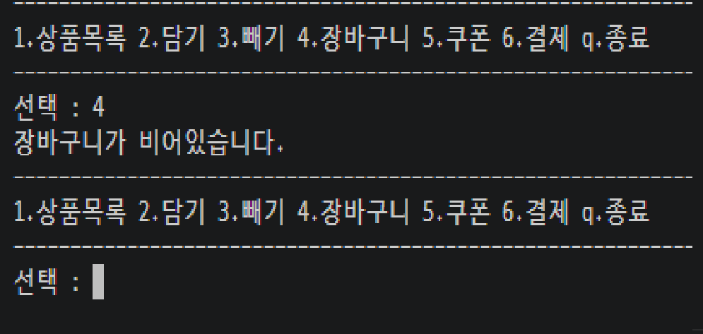
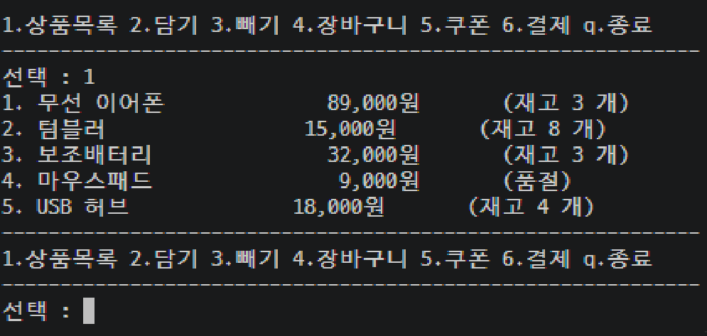
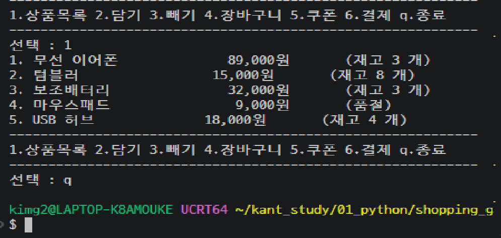

# 쇼핑몰 장바구니

## 실행 방법
    - F5 로 실행 
    - 1번 상품목록 : 등록된 상품들을 출력
    - 2번 담기 : 상품을 선택하고 수량을 입력해 입력한 수량만큼 바구니에 담기
    - 3번 장바구니에 넣은 물품을 입력한 수량만큼 제거
    - 4번 장바구기 : 장바구니 내용물 출력
    - 5번 쿠폰 : 쿠폰 리스트 출력 및 적용할 구폰 선택
    - 6번 장바구니 물품 결졔
    - q 종료 : 입력받을때 q를 누르면 퇴장 

## 구현한 기능 소개

- 처음 시작화면

1. 상품목록 

- 1번 상품 목록을 Goods 클래스를 생성해 시작할때 생성을 미리하고 그걸 1번을 입력했을때 goods_list함수를 호출해 출력하게 했습니다.

2. 담기

- 2번 담기를 호출했을때 goods_add_basket함수를 호출하고 품절 상품인지 아닌지 확인후에 품절상품이면 다시 선택하도록 하고 품절상품이 아니면 item_add_basket함수를 사용해 items_basket 배열에 저장합니다.
- 저장할때 items_basket에 담겨있는 물품과 비교해 같은 물품이면 더해서 추가합니다.
3. 빼기

- 3번 빼기를 입력하면 goods_remove_basket_main 함수를 호출하고 show_basket함수를 호출해서 장바구니용 배열 items_basket에 담긴 물품들을 출력하고 담긴 물품이 없으면 다시 처음으로 돌아갑니다.
- 물품 목록을 출력한 후 goods_remove_basket함수를 호출해 제거할 물품을 선택하고 , 수량을 입력받은뒤 담은 수량과 제거할 수량을 비교해 같으면 물품을 장바구니에서 완전히 제거 
- 장바구니 물품이 더 적으면 입력숫자만끔 빼고 저장, 장바구니 물품보다 입력숫자가 많으면 경고문구 출력후 재입력시킵니다.
4. 장바구니

- 4번을 입력하면 show_basket_main함수를 호출해 items_basket에 담겨있는 물품들의 물품명과  가격, 재고 , 장바구니 수량을 출력하고 처음으로 돌아갑니다.
5. 쿠폰

- 5번을 입력하면 쿠폰을 출력하기 위해 coupon_ck_main함수를 호출해서 coupon_list_text배열에 넣어둔 쿠폰 설명을 for 문을 통해 출력하고 사용자가 선택한 쿠폰 번호를 coupon 변수에 저장해서
- 선택한 쿠폰의 설명을 화면에 출력합니다.
6. 결제 

- 6을 입력하면 지금까지 장바구니에 넣고 쿠폰을 선택해 할인을 적용받은 상태로 금액을 비교하고 3만원 미만면 3천원 이상이면 0원을 추가해 총 결제를 진행하고
- 실제 물품의 수량에서 장바구니의 수량을 제거해 업데이트 합니다.

7. q. 종료

- 모든 입력화면에서 q를 입력하면 바로 종료됩니다.

8. 후기
- 시간이 부족해 클래스 활용을 못했고 while을 통한 반복이 아닌 함수 재호출을 통해 재실행을 하다보니 코드가 길어지고 안정성이 떨어집니다.
- 추후 업데이트로 수정하도록 하겠습니다. 